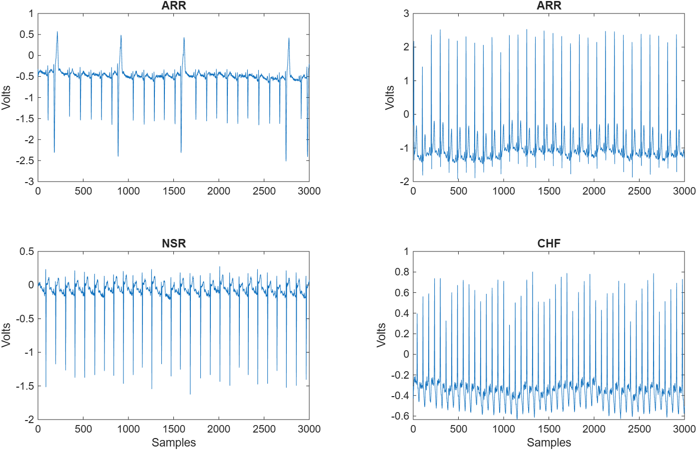
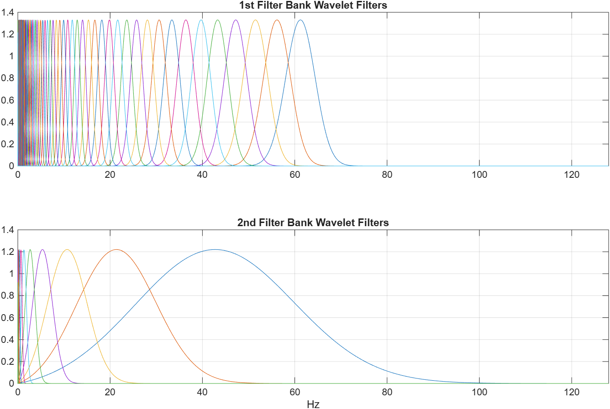
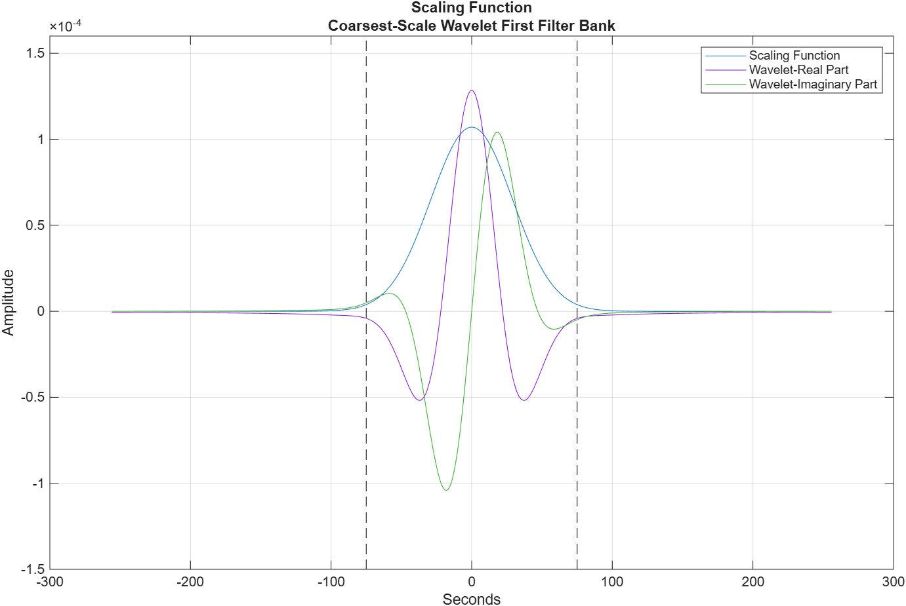
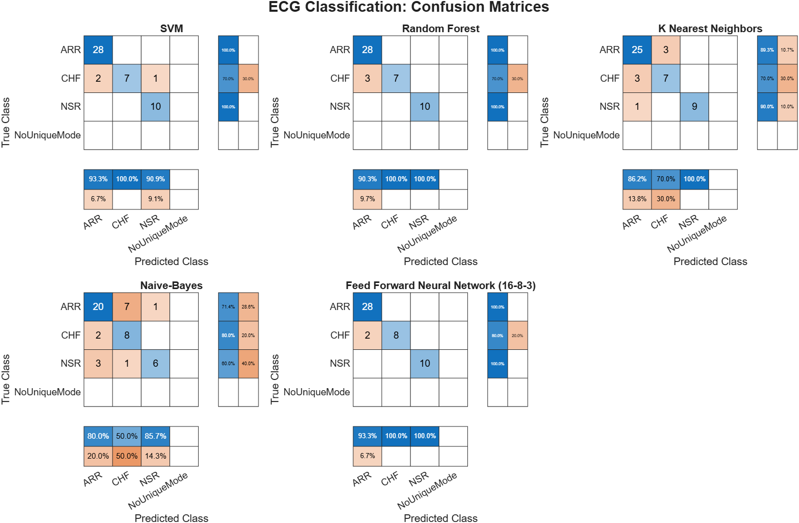
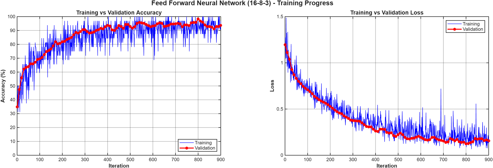

# ECG Signal Classification Analysis

This project compares machine-learning classifiers for ECG recordings from three PhysioNet sources: the [MIT-BIH Arrhythmia Database](https://physionet.org/content/mitdb/1.0.0/), the [BIDMC Congestive Heart Failure Database](https://physionet.org/content/chfdb/1.0.0/), and the [MIT-BIH Normal Sinus Rhythm Database](https://physionet.org/content/nsrdb/1.0.0/). The code assigns each preprocessed ECG channel a database-derived label: arrhythmia (ARR), congestive heart failure (CHF), or normal sinus rhythm (NSR). The results reported below are from one run of the script with the random seed set to 95.

The raw recordings are read with `rdsamp` from the Waveform Database Software Package (WFDB) for MATLAB and Octave. Silva, I., Moody, B., & Moody, G. (2021). *Waveform Database Software Package (WFDB) for MATLAB and Octave* (version 0.10.0). PhysioNet. RRID:SCR_007345. [https://doi.org/10.13026/6zcz-e163](https://doi.org/10.13026/6zcz-e163)

Figure 1. Example post-processed signals: ARR (top left and top right), NSR (bottom left), and CHF (bottom right).

## 1. Feature Extraction: Wavelet Scattering

The following preprocessing steps are applied before feature extraction:

- Each ECG channel is resampled to 128 Hz.
- Recordings with multiple ECG leads are separated into individual channels.
- Each channel is truncated or zero-padded to 2^16 = 65,536 samples.

Feature extraction is performed with MATLAB's `waveletScattering` function, following the approach in MathWorks' [Wavelet Time Scattering for ECG Signal Classification](https://www.mathworks.com/help/wavelet/ug/ecg-signal-classification-using-wavelet-time-scattering.html) example.

| Scattering setting | Value |
| --- | --- |
| Signal length | 65,536 samples (`2^16`) |
| Sampling frequency | 128 Hz |
| Invariance scale | 150 seconds |
| Filter banks | MATLAB default: two filter banks |
| Wavelets per octave | MATLAB default: 8 in the first filter bank and 1 in the second |

### Why Wavelet Scattering

Wavelet scattering is used here to create structured features from ECG signals.

ECG recordings may vary across people and recording conditions, may contain noise and baseline wander, and may exhibit patterns across multiple time scales. Each input channel contains 65,536 samples, so a compact feature representation makes comparison with classical machine-learning models more practical.

Wavelet scattering applies cascades of wavelet transforms, nonlinearities, and averaging to produce low-variance feature representations. At the configured invariance scale, these representations are locally insensitive to time shifts and stable to small deformations while retaining class-discriminative information. The resulting features are more compact than the raw sampled signals and retain structure across multiple temporal scales.

Wavelet scattering also has trade-offs. Its architecture is fixed rather than learned from the data, its coefficients can be less directly interpretable than handcrafted clinical features, and it has computational cost. These trade-offs should be considered when interpreting the results.

### Features
The feature tensor has shape `409 × 16 × Ntrain`: 409 scattering paths, 16 scattering time windows per preprocessed ECG channel, and one tensor page for each channel in the training partition. `Ntrain` is determined by the train/test split.

Figure 2. Frequency responses of the first- and second-stage wavelet filter banks.

Figure 3. Scaling function and real and imaginary parts of the wavelet at the coarsest scale of the first filter bank.

## 2. Model Comparison

The quadratic SVM was the classification model used in the original MathWorks example. The other models were added to compare different approaches using the same wavelet-scattering features. The results below are from the fixed-seed run (seed 95).

| Model | Test Accuracy | Macro F1 | Runtime (fit + prediction) |
| --- | ---: | ---: | ---: |
| Feed Forward Neural Network (16-8-3) | 95.833% | 0.95147 | 5.7352 s |
| Random Forest | 93.750% | 0.92423 | 1.7621 s |
| SVM | 93.750% | 0.91381 | 0.19722 s |
| K-Nearest Neighbors | 85.417% | 0.84152 | 0.067566 s |
| Naive Bayes | 70.833% | 0.69199 | 0.075344 s |

### Macro-Score Handling

If the majority vote for a processed ECG channel is tied, `helperMajorityVote` returns `NoUniqueMode`. This outcome remains visible in the confusion matrix and class-level metrics. Macro precision, macro recall, and macro F1 are averaged only over ARR, CHF, and NSR; `NoUniqueMode` is not treated as a fourth class in those averages. A tied prediction is still incorrect for the true class and therefore affects accuracy and the true class's recall.

### Classification Metrics Comparison

- The feedforward neural network had the highest observed accuracy and macro F1 in this seed-95 run.
- The Random Forest and SVM had the same accuracy. The Random Forest had the higher macro F1, while the SVM was substantially faster.
- KNN outperformed Naive Bayes on both accuracy and macro F1 in this run.

### Runtime Comparison

- KNN was the fastest model at 0.067566 seconds.
- Naive Bayes was the next-fastest model at 0.075344 seconds, but had the lowest accuracy and macro F1.
- The SVM achieved 93.750% accuracy in 0.19722 seconds.
- The neural network required the longest runtime at 5.7352 seconds.

### Runtime Environment

The reported runtimes were measured on the author's personal computer using MATLAB R2026a Update 3. They are relative comparisons within this run, not hardware-independent benchmarks.

## 3. Detailed Findings

- Best observed model: Feed Forward Neural Network (16-8-3), with 95.833% accuracy and a macro F1 of 0.95147.
- Fastest model: K-Nearest Neighbors, with a runtime of 0.067566 seconds.
- Best trade-off: The SVM is the preferred model for this project because it matched the Random Forest's 93.750% accuracy while running about nine times faster. Its macro F1 was slightly lower than the Random Forest's, so this is a speed-versus-metric trade-off rather than a universal choice.

Different priorities could support different model choices:

- SVM: Strong balance of accuracy, macro F1, and runtime.
- Feedforward neural network: Best observed metrics in this run, at the cost of the longest runtime.
- Random Forest: Appropriate when the small macro-F1 improvement over the SVM is worth a longer runtime.
- KNN: The fastest model and a stronger lightweight baseline than Naive Bayes in this run.
- Naive Bayes: A simple probabilistic baseline, but it had the weakest evaluation metrics in this run.

## 4. Confusion Matrix Analysis

### Classes That Were Easiest to Classify

Across the displayed holdout results, ARR and NSR generally had higher recall than CHF; the relative ordering of ARR and NSR varies by model. Errors most often involved ARR and CHF. This pattern describes this split and does not establish a clinical explanation for the differences in classification difficulty.

Figure 4. Confusion matrices for the ECG classifiers.

## 5. Neural Network Training

The feedforward neural network uses a 16-8-3 architecture with batch normalization, ReLU activations, dropout, and Adam optimization. During training, 20% of the training processed ECG channels are reserved for validation. Each channel's validation assignment is repeated across its scattering windows, so windows from one processed channel do not appear in both the neural-network training and validation sets.

### Training Versus Validation Curves

Training and validation accuracy rise together and finish in a similar range, while both losses decline and remain close. The training trace is noisier because it is recorded for individual mini-batches, whereas validation is measured less often. There is no sustained separation in which training improves while validation worsens, so these curves show no obvious sign of overfitting during this run. They are a useful within-run fit check, but they do not establish generalization to independent data.

The current run produced a lower neural-network test accuracy than the earlier 100% result obtained with window-level validation. Holding out complete processed ECG channels prevents the model from validating on windows from channels it also sees in training and reduces the number of channels available for fitting. However, if the random seed, outer train/test split, or stochastic training conditions also changed, the decrease cannot be attributed to grouping alone. The grouped approach nevertheless provides a more credible validation procedure.

Figure 5. Training and validation curves for accuracy and loss.

### Cross-Validation Interpretation

The original MATLAB example performs 5-fold cross-validation over individual wavelet-scattering windows. Because each processed ECG channel produces multiple windows, this approach can assign windows from the same channel to both a training fold and its respective test fold. Windows from the same channel are likely to be similar, which can inflate the reported cross-validation accuracy.

For its SVM cross-validation analysis, this project uses channel-grouped cross-validation. The `groupedCrossValidation` function assigns one of five folds to each processed ECG channel and repeats that assignment across the channel's `Nwin` scattering windows. All windows associated with a processed channel are therefore used in the same training or test fold to prevent window-level leakage. The seed-95 run produced the following results:

> Evaluation unit: One preprocessed ECG channel. Multi-lead recordings are separated into channels before splitting and feature extraction.
>
> Cross-validation setup: Five folds across 162 processed ECG channels, with random seed 95.
>
> Window-level result: 93.1713%. This measures individual scattering-window predictions, so it is useful for checking the window classifier but is not the final channel-level accuracy.
>
> Channel-level result: 95.0617%. This uses a majority vote across a processed ECG channel's 16 windows and is the primary cross-validation accuracy for this project.
>
> Window-level fold stability: 93.1297% ± 3.4297% (mean ± standard deviation across five folds). This shows whether window-level performance was similar across the held-out folds.
>
> Interpretation: The higher channel-level CV accuracy is expected because a channel can receive the correct majority-vote label even when some of its individual scattering windows are misclassified. This does not by itself establish performance on independent participants, recordings, or data sources.
>
> Remaining limitation: A processed channel is the grouping unit. The current code does not retain a raw-record or participant identifier, so related leads or recordings from the same participant could still appear in different folds.

## 6. Conclusions

- Wavelet-scattering features produced strong classification performance in this seed-95 run.
- The SVM and Random Forest both achieved 93.750% accuracy.
- The feedforward neural network achieved the best observed result: 95.833% accuracy and a macro F1 of 0.95147.
- The SVM is the preferred model for this project because it combines high performance with a substantially shorter runtime than the neural network and Random Forest.

## Limitations and Future Work

- Cross-validation grouping: The current implementation keeps all windows from one processed channel in the same fold. Future work should group related leads, source records, and—where available—participant identifiers, then evaluate on a fully independent external dataset.
- Evaluation separation: The grouped cross-validation analysis uses all processed channels, including those later used in the separate holdout evaluation. It is therefore a separate cross-validation analysis, not an independent confirmation of the holdout results.
- Dataset-source confounding: ARR, CHF, and NSR originate from different PhysioNet databases. A model may partially learn database, acquisition, or signal-quality differences rather than only physiological class differences. External validation is needed to assess this risk.
- Generalization: The current evaluation uses 162 processed ECG channels, which is small for a clinical generalization claim. A larger independent dataset should be used to test whether the results hold up.
- Stability across random seeds: These results come from one fixed seed (95) and do not establish stable performance. Future work should compare multiple seeds, repeated grouped splits or folds, and confidence intervals.
- Metric reporting: Accuracy, macro F1, precision, and recall are calculated. Future analyses should report class-level metrics and confidence intervals for channel-level accuracy and macro F1.
- Clinical scope: This is an educational portfolio project and is not validated for clinical use.
