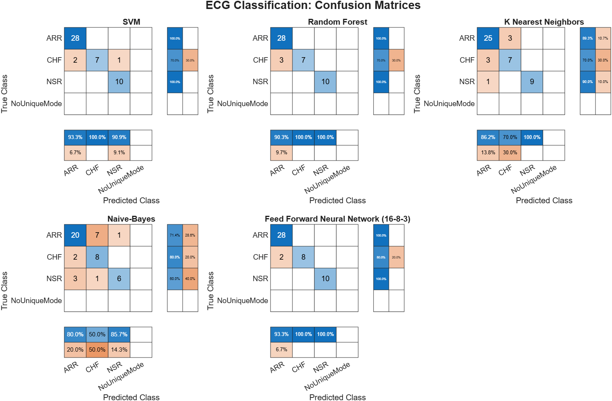

# ECG Signal Classification with Wavelet Time Scattering

> My personal project comparing machine-learning classifiers for electrocardiogram (ECG) signal classification.

## Project Overview

This project compares several machine-learning classifiers for distinguishing ECG signals across three classes:

- **ARR** — Arrhythmia
- **CHF** — Congestive Heart Failure
- **NSR** — Normal Sinus Rhythm

The pipeline preprocesses raw ECG recordings, extracts features with a wavelet time scattering transform, trains multiple classifiers, and compares their performance. The models included are a support vector machine, random forest, k-nearest neighbors, Naive Bayes classifier, and feedforward neural network, and further information can be found in the [Analysis.md](Analysis.md).

This is my independent student portfolio project that spun out of MathWorks' [Wavelet Time Scattering for ECG Signal Classification](https://www.mathworks.com/help/wavelet/ug/ecg-signal-classification-using-wavelet-time-scattering.html) example.

## Project Goals

- Build an end-to-end ECG classification workflow in MATLAB.
- Compare traditional machine-learning models and a feedforward neural network.
- Explore wavelet time scattering as an ECG feature-extraction method.
- Improve my MATLAB proficiency

## Workflow

1. Select the parent folder containing the raw ECG recordings (see sourcing information below).
2. Preprocess each ECG channel to a common sampling rate and length.
3. Split the processed ECG channels into training and test sets.
4. Extract wavelet time scattering features.
5. Train and evaluate each classifier.
6. Aggregate window-level predictions into one prediction per processed ECG channel using majority vote.
7. Observe and analyze results with summary tables, confusion matrices, and neural-network training curves.

## Repository Guide

| File | What's Inside |
| --- | --- |
| `main.m` | Main entry point. Selects the raw-signal folder, runs preprocessing, extracts features, trains models, and displays results. Run this file to observe the comprehensive project.|
| `ECGPreprocessor.m` | Class for loading and standardizing ECG recordings from the selected data folder. |
| `SVMClassifier.m` | Trains and evaluates the support vector machine classifier. |
| `RandForestClassifier.m` | Trains and evaluates the random forest classifier. |
| `KNNClassifier.m` | Trains and evaluates the k-Nearest Neighbors classifier. |
| `NaiveBayesClassifier.m` | Trains and evaluates the Naive Bayes classifier. |
| `FeedForwardNeuralNetClassifier.m` | Trains and evaluates the feedforward neural network. |
| `randomSplit.m` | Creates a reproducible training/test split. |
| `unpackData.m` | Extracts the signal matrix and labels from the preprocessed dataset. |
| `createSequenceLabels.m` | Matches labels to wavelet-scattering time windows. |
| `helperMajorityVote.m` | Combines window-level predictions into one prediction per processed ECG channel. |
| `groupedCrossValidation.m` | Performs SVM cross-validation while keeping all windows from a processed ECG channel in the same fold. |
| `computeClassificationMetrics.m` | Calculates accuracy, class-level metrics, and macro-averaged scores. |
| `displayResults.m` | Ranks and prints classifier results. |
| `plotConfusionMatrices.m` | Creates confusion-matrix visualizations for each model. |
| `plotNNTrainingCurves.m` | Visualizes neural-network training and validation progress. |
| `DownloadInstructions.txt` | Instructions on how to download and arrange the datafiles, as well as install the Waveform Database toolbox.|
| `Analysis.md` | Analysis on the project, including validation, limitations and areas of future improvement. |
| `Images/` | Saved figures used in the README and analysis. |
| `Past Versions_prototype/` | Archived prototype code and unused classifier versions. |

## Results

For detailed results, runtime comparisons, figures, validation methodology, and limitations, see [Analysis.md](Analysis.md).

| Model | Test Accuracy | Macro F1 Score |
| --- | ---: | ---: |
| Feed Forward Neural Network (16-8-3) | 95.833% | 0.95147 |
| Random Forest | 93.750% | 0.92423 |
| SVM | 93.750% | 0.91381 |
| K-Nearest Neighbors | 85.417% | 0.84152 |
| Naive Bayes | 70.833% | 0.69199 |



Figure 1. Confusion matrices for the five evaluated classifiers.

## Requirements

This project was developed in MATLAB. Before running it, install or configure:

- MATLAB (created in version R2026a Update 3)
- Wavelet Toolbox
- Statistics and Machine Learning Toolbox
- Deep Learning Toolbox
- Signal Processing Toolbox
- Waveform Database Software Package (WFDB) for MATLAB and Octave
    - Instructions can be found in [DownloadInstructions.txt](DownloadInstructions.txt)

## Data Setup

Raw ECG data is not included in this repository. Follow [DownloadInstructions.txt](DownloadInstructions.txt) to download the data, arrange it locally, and install the WFDB toolbox.

When prompted by `main.m`, select the parent folder containing these subfolders:

```text
your-data-folder/
├── mitdb/
├── chfdb/
└── nsrdb/
```

The source data originates from the [MIT-BIH Arrhythmia Database](https://physionet.org/content/mitdb/1.0.0/), [BIDMC Congestive Heart Failure Database](https://physionet.org/content/chfdb/1.0.0/), and [MIT-BIH Normal Sinus Rhythm Database](https://physionet.org/content/nsrdb/1.0.0/). Preserve the required data licenses and attributions when obtaining or using the files.

## How to Run

1. Clone or download this repository.
2. Install the required MATLAB toolboxes and the WFDB toolbox using [DownloadInstructions.txt](DownloadInstructions.txt).
3. Download and arrange the source data as described in [DownloadInstructions.txt](DownloadInstructions.txt).
4. Open MATLAB in the project folder.
5. Run `main.m`.
6. Select the parent folder containing the raw ECG data when prompted.
7. Review the printed model summary and visualizations.

A random seed is declared near the top of `main.m` so that the training/test split, cross-validation, visualization sampling, and neural-network validation split can be reproduced.

## Attribution

The project was inspired by MathWorks' [Wavelet Time Scattering for ECG Signal Classification](https://www.mathworks.com/help/wavelet/ug/ecg-signal-classification-using-wavelet-time-scattering.html) example. The ECG source data is obtained from PhysioNet; dataset-specific citations and license information should be retained with the data setup materials.

### Software Citation

This project uses the Waveform Database Software Package (WFDB) for MATLAB and Octave to read WFDB-formatted ECG recordings through `rdsamp`.

Silva, I., Moody, B., & Moody, G. (2021). *Waveform Database Software Package (WFDB) for MATLAB and Octave* (version 0.10.0). PhysioNet. RRID:SCR_007345. [https://doi.org/10.13026/6zcz-e163](https://doi.org/10.13026/6zcz-e163)

## Author

**Luke Mehta**  
*BME + CS, Johns Hopkins University*

## License

This project's original code is released under the MIT License. The external datasets and WFDB software retain their own licenses, citation requirements, and terms of use.
